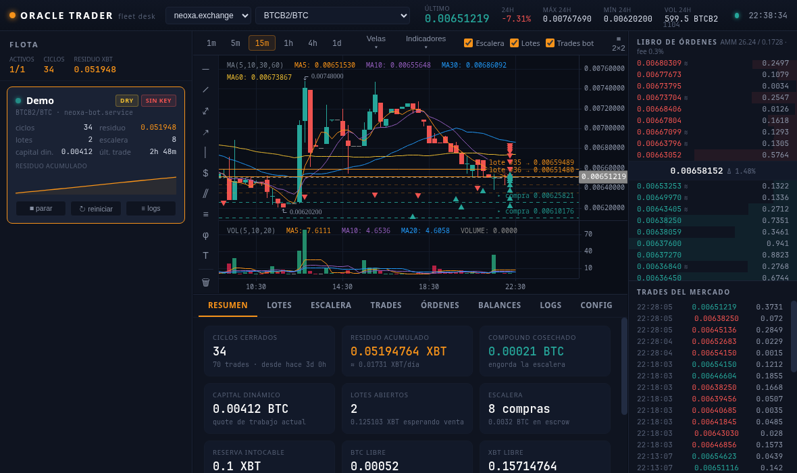
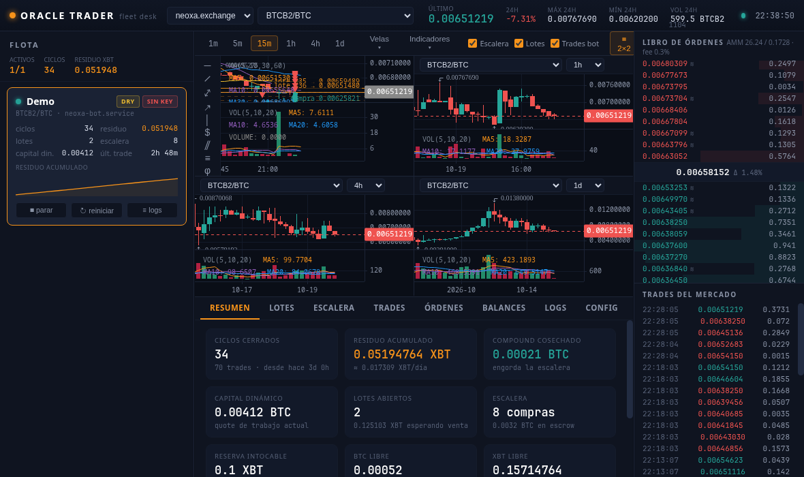

# Oracle Trader

**Trading desk de escritorio + bot acumulador spot para el mercado XBT (BTCB2)** — self-hosted, 100% local, sin servicios de terceros. Gráficos estilo TradingView con la estrategia del bot pintada sobre el precio.

*Desktop trading desk + spot accumulation bot for the XBT (BTCB2) market on neoxa.exchange. Self-hosted and fully local. Docs are in Spanish — the code comments too; PRs welcome.*



## Las dos piezas

| | |
|---|---|
| **El motor** ([`bot/`](bot/)) | Bot Python de acumulación spot: escalera de compras + venta por lote + trailing take-profit con piso sagrado, compound, multi-cuenta por instancias systemd. Backtesting con el mismo código del bot. [Documentación de la estrategia →](bot/README.md) |
| **El dashboard** (raíz) | App Electron que administra la flota: gráfico estilo TV (velas/Heikin Ashi/línea, indicadores editables, dibujo persistente), escalera/lotes/trades del bot sobre el gráfico, control systemd por cuenta, libro con AMM, multi-chart 2×2, tray. Solo-lectura contra el exchange: operar es trabajo del bot. |

## Dashboard — características

- **Gráfico estilo TradingView** (KLineCharts): 1m–1d, tipos velas / huecas / **Heikin Ashi** / OHLC / línea, indicadores **con editor** (períodos y colores por línea, persistentes), herramientas de dibujo (tendencias, canales, fibonacci…) que se guardan por par.
- **La estrategia visible**: escalera de compras (líneas verdes), objetivo de cada lote (naranjas), cada trade del bot como ▲/▼ en su vela.
- **Flota multi-cuenta**: descubrimiento automático (cuenta principal + `instances/*`), estado systemd en vivo, arrancar/parar/reiniciar con confirmación, sparkline de residuo por cuenta.
- **Detalle por cuenta**: resumen, lotes con distancia al objetivo y estado del trailing, escalera, trades con margen, órdenes/balances live del exchange, logs del journal, config.
- **Mercado**: libro de órdenes con el AMM marcado (`≋`) y estado del pool, trades del mercado, ticker 24h.
- **Historia profunda opcional**: fusiona el archivo público [xbt-market-data](https://github.com/MarcanoFilms/xbt-market-data) con la ventana live de la API (que solo da 1000 velas) — el mercado completo desde su génesis. Ver [Archivo de velas](#archivo-de-velas-opcional).
- Paneles redimensionables/colapsables, `F` fullscreen, `G` multi-chart 2×2, icono de bandeja con precio y estado de los bots.
- Las credenciales **nunca** llegan a la UI: el proceso principal lee los `.env` del bot y el renderer solo recibe datos por IPC con lista blanca.

## Arranque rápido

```bash
# Dashboard (Node 20+)
npm install
npm start

# ¿Sin bot todavía? Modo demo con una flota ficticia:
ORACLE_BOT_ROOT=./demo npm start
```

```bash
# Bot (Python 3.10+) — guía completa en bot/README.md
cd bot
python -m venv venv && ./venv/bin/pip install -r requirements.txt
cp config.example.yaml config.yaml    # capital, reserva, geometría
cp .env.example .env                  # API key del exchange
./venv/bin/python run.py              # SIEMPRE empezar con dry_run: true
```

El dashboard busca el bot en `~/Projects/neoxa-bot` y si no existe usa `./bot`
(configurable en `~/.config/oracle-trader/settings.json` → `botRoot`). Para el
servicio systemd del bot hay plantillas en [`bot/systemd/`](bot/systemd/).

> ⚠️ **Descargo**: este software opera dinero real en un exchange. Úsalo bajo tu
> única responsabilidad, empieza en `dry_run` y con capital que puedas perder.
> No es consejo financiero.

## Capturas

| Trading desk | Multi-chart 2×2 |
|---|---|
|  |  |

## Arquitectura

```
main.js                proceso principal: TODA la E/S vive aquí
src/
  settings.js          config de la app + dibujos (~/.config/oracle-trader)
  fleet.js             descubre cuentas del bot, lee config/estado, systemd, journal
  archive.js           lector del archivo histórico de velas (CSV)
  exchanges/           adaptadores de exchange (hoy: neoxa; interfaz de 6 métodos)
preload.js             puente IPC con lista blanca de canales
renderer/              UI sin framework ni build: app.js + chart.js + styles.css
bot/                   el motor (Python) — ver bot/README.md
demo/                  flota ficticia para probar el dashboard sin bot
```

Decisiones de diseño (para quien quiera auditar — empezad por `src/` y
[`bot/neoxa_bot/accum.py`](bot/neoxa_bot/accum.py); los tests del bot están en
`bot/test_*.py`):

- **Solo lectura contra el exchange** desde el dashboard: observa velas, libro,
  balances y órdenes; jamás coloca ni cancela órdenes. El control es sobre el
  *servicio* systemd del bot.
- **El bot es la fuente de verdad**: lotes, escalera y trades salen de su
  `state.json`; el dashboard no duplica estado.
- **Credenciales confinadas al proceso principal**; renderer sin
  `nodeIntegration`, IPC con lista blanca, CSP sin orígenes externos.
- **Multi-exchange por adaptadores**: implementar
  `candles/ticker/orderbook/marketTrades/balances/openOrders` en
  `src/exchanges/` y registrarlo — el resto no cambia.

## Archivo de velas (opcional)

La API del exchange solo expone ~1000 velas por intervalo (el 1m caduca en
días). El dashboard fusiona un archivo local de CSVs con la ventana live para
mostrar toda la historia del mercado — y ese archivo ya existe y es público:

**[MarcanoFilms/xbt-market-data](https://github.com/MarcanoFilms/xbt-market-data)** —
registro del mercado XBT desde su génesis (2026-09-01), actualizado cada 15 min.

```bash
git clone https://github.com/MarcanoFilms/xbt-market-data ~/Projects/xbt-market-data
# (la ruta por defecto de archiveRoot; otra ruta → settings.json → archiveRoot)
```

Formato: `data/<exchange>/<par>/<intervalo>/<YYYY-MM>.csv` con header
`time,open,high,low,close,volume` (epoch segundos UTC). El colector que lo
mantiene al día (Node + systemd timer) vive en ese repo. Sin archivo, el
dashboard funciona igual con la ventana de la API.

## Roadmap

- [ ] Adaptador **nonkyc.io** (misma familia de API) y genérico vía **ccxt**.
- [ ] Registro de cuentas con exchange+par+credenciales arbitrarios.
- [ ] Curva de equity / residuo acumulado por cuenta.
- [ ] Backtesting visual: pintar el resultado de `backtest_accum.py` sobre el gráfico.
- [ ] Herramienta de medición estilo TV y editor de config con validación.
- [ ] Notificaciones nativas (ciclo cerrado, trailing activado, bot caído).

## Contribuir

Issues y PRs bienvenidos — auditorías de seguridad especialmente. El bot no se
toca sin backtest (`bot/backtest_accum.py` corre el mismo código contra velas
reales) y sus invariantes son innegociables.

## Licencia

[MIT](LICENSE) © MarcanoFilms
